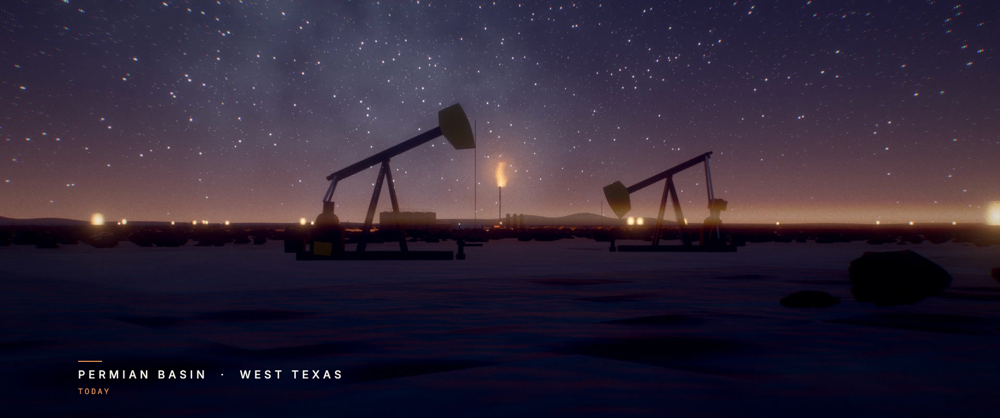
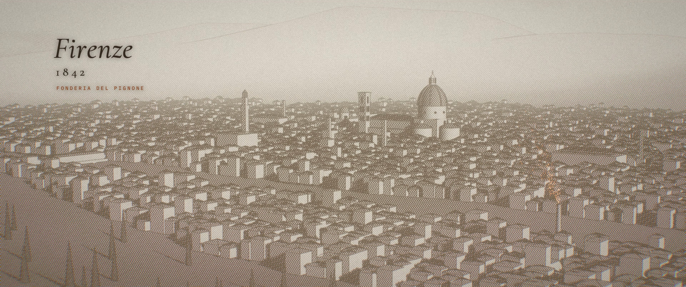
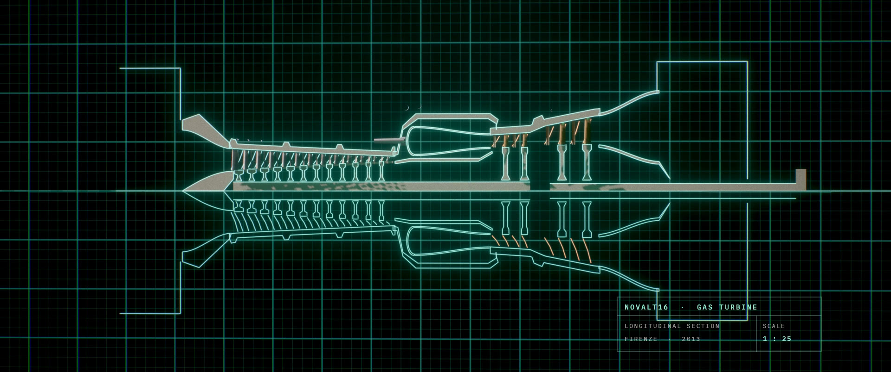
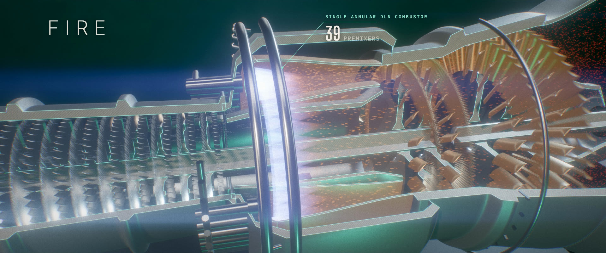
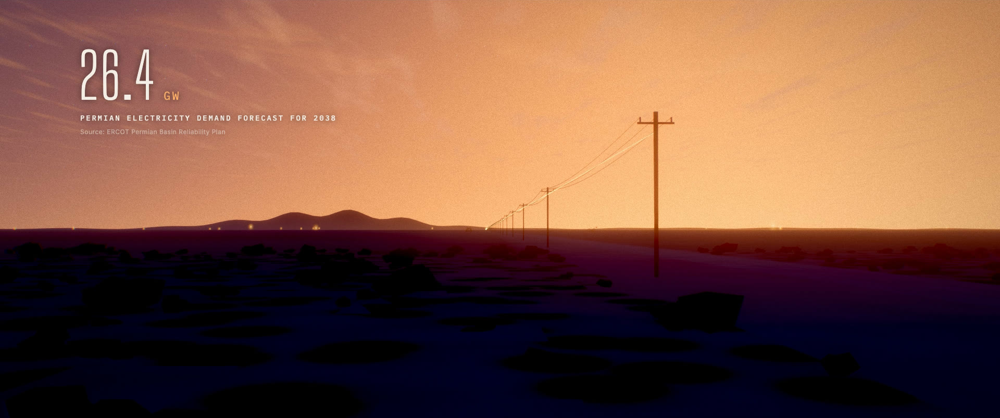
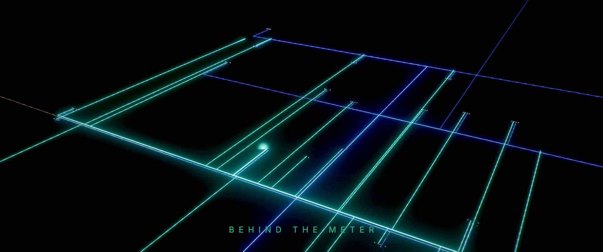
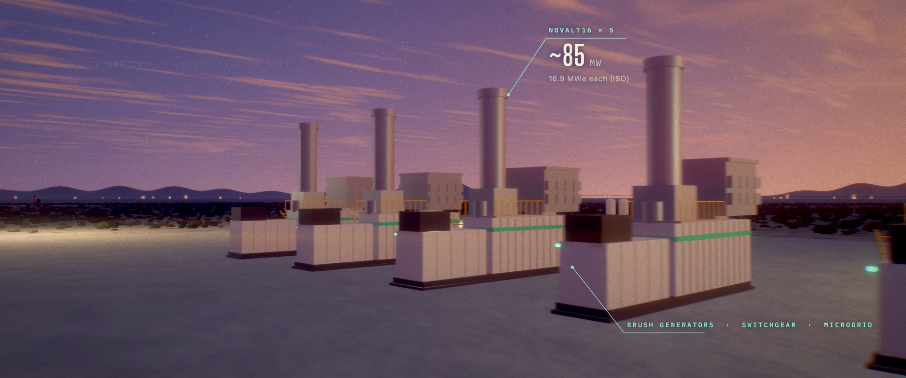

# THE SAME FIRE

**NovaLT™ and the future of gas-to-power — a 2:55 film rendered entirely in code.**



### ▶ Watch
- **[Download the film (MP4, 1080p, 156 MB)](https://github.com/granttrudeau/gastopower/releases/download/v1.0/THE_SAME_FIRE_1080p_web.mp4)**
- Higher quality, captions and notes: **[Release v1.0](https://github.com/granttrudeau/gastopower/releases/tag/v1.0)**

| | | |
|---|---|---|
|  |  |  |
|  |  |  |

Half history, half future. The first half traces the lineage from a Florence foundry (1842) through Nuovo Pignone and GE to Baker Hughes. It then shows the NovaLT16 in a revolving technical cutaway. The second half makes the case for **gas-to-power as a service**: behind-the-meter NovaLT power islands running on field gas for upstream operators in the Permian. Every figure is sourced in [`out/sources_and_facts.md`](out/sources_and_facts.md). The service model is presented as an opportunity, not a current offer.

Every frame, sound and word is generated by the code in this repository. There is no footage, stock art or samples.

## What's here
| Path | What it is |
|---|---|
| `film/` | The film: a WebGL (three.js r186) renderer with 13 shots, a shared engine, and procedural worlds |
| `film/edit.json` | The edit: shot timings, transitions and narration cue times (single source of truth) |
| `film/src/engine/` | Frame engine: HDR rendering, temporal supersampling (motion blur + AA), bloom, anamorphic streaks, heat haze, god rays, AgX tone mapping, grading, grain, typography |
| `film/src/world/` | Permian Basin world (terrain, scrub, pumpjacks, flares, facilities, power island), sky, volumetric flame, Florence etching city, glowing diagram lines |
| `film/src/turbine/` | The NovaLT16 cutaway model (12-stage compressor, 39-premixer annular combustor, HP and power turbines, gearbox, generator) |
| `film/src/shots/` | One module per shot (`s01_nightglow` … `s13_finale`) |
| `audio/` | Narration (`script.json`, `tts.py`), score and sound design (`synth.py`, `score.py`), mix (`mix.py`) |
| `render/` | Headless-Chrome frame capture → ffmpeg (`render.py`), stills for review (`stills.py`) |
| `out/` | Deliverables |

## Setup (to preview or re-render)
```bash
python3 -m venv .venv && .venv/bin/pip install -r requirements.txt
# narration model (Kokoro-82M), only needed to regenerate the voice:
mkdir -p tools/kokoro && cd tools/kokoro && \
  curl -LO https://github.com/thewh1teagle/kokoro-onnx/releases/download/model-files-v1.0/kokoro-v1.0.onnx && \
  curl -LO https://github.com/thewh1teagle/kokoro-onnx/releases/download/model-files-v1.0/voices-v1.0.bin
```
Requires Google Chrome. The renderer uses WebGL2 on your GPU through headless Chrome. The commands below use `tools/venv/bin/python`; substitute `.venv/bin/python` if you set up this way.

## Preview live in a browser
```bash
python3 -m http.server 8000
```
Then open http://localhost:8000/film/index.html. Space plays and pauses, the arrow keys step frames, and the quality menu sets the resolution. The page plays the soundtrack in sync: `audio/mix.wav` if you've rendered it, otherwise the committed `audio/mix.m4a`.

## Re-render
```bash
tools/venv/bin/python render/render.py --scale 1 --sub 8 --out out/master/video.mp4        # master picture (~40 min on an M1)
tools/venv/bin/python render/render.py --scale 0.5 --sub 1 --jpeg --out out/preview.mp4    # quick preview (~5 min)
cd audio && ../tools/venv/bin/python score.py && ../tools/venv/bin/python mix.py            # score + mix (-16 LUFS)
```
Then mux picture and sound with the bundled ffmpeg (see the final command in the project log).

## Narration
The voice is a local neural TTS (Kokoro-82M, a blend of three stock male voices) directed toward a low, restrained documentary read. It is **not** a clone of any real person. To use a professional voice-over:
1. Record each line in `out/narration_script_timed.md`.
2. Save the lines as `audio/vo/v01.wav` … `v27.wav`.
3. Run `audio/mix.py`.
The cue times are in `film/edit.json`.

## Facts
See `out/sources_and_facts.md` for every on-screen number and its source.
